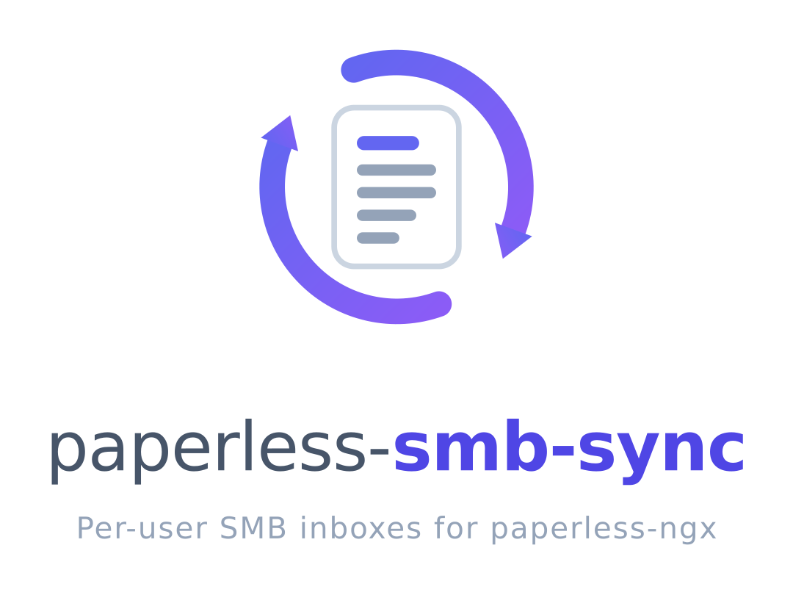

<!-- markdownlint-disable-file MD033 MD041 -->
<div align="center">
  <picture>
    <source media="(prefers-color-scheme: dark)" srcset="assets/logo-dark.png">
    
  </picture>
</div>

`paperless-smb-sync` is a single container that serves per-user SMB inbox shares for a [multi-user paperless-ngx
setup](https://blog.flobernd.de/2026/02/paperless-ngx-document-management/) and keeps those shares in sync with
paperless group membership. Add a user to a paperless group and the container creates their Samba account, their inbox
folder, and a consumption workflow that files scans under their name. Remove them from the group and it tears the same
things back down.

## How it works

### The reconcile loop

The container runs `smbd` in the foreground and a Python sync daemon in the background. The daemon runs a cycle, waits
`POLL_INTERVAL` seconds and then runs the next one. A cycle fetches the desired state from the paperless API (who is a
member of `SYNC_GROUP` and whether each member is active) and the actual state (Samba accounts, inbox folders, managed
workflows), then applies whatever actions close the gap. Reconciliation is level-based: each cycle plans from the state
it reads, so the next cycle completes one that crashed or stopped half way.

`smbd` is the main process of the container, so its exit stops the container. When the daemon exits, the entrypoint
starts it again after five seconds.

The daemon logs each warning when its cause first appears, and again once per hour while the cause lasts. A manual
`smb-sync sync` logs each warning of its cycle.

### Start and health

The container exits at start when its configuration is not valid: `PAPERLESS_URL` is missing, the token is missing or
empty or cannot be read, both token variables are set, a numeric setting is not a number, `POLL_INTERVAL` is below 1,
`CREDENTIALS_DOCUMENT` has an unknown value, or `PAPERLESS_CONSUMPTION_DIR` is not valid. It also exits when Samba
rejects the merged `smb.conf`, as described under Custom Samba configuration below.

`docker ps` shows a health state. The container turns unhealthy when the daemon has completed no cycle for three poll
intervals, or for three minutes when that is longer. Docker shows that state after three failed checks, which run 30
seconds apart. A cycle that fails counts as completed, so an unreachable paperless does not make the container
unhealthy. A cycle that runs longer than this threshold reads unhealthy until it ends. Docker does not restart an
unhealthy container on its own.

### Opt-in by group membership

Only paperless users who belong to `SYNC_GROUP` (default `smb`) are provisioned. Other users, including admin and
service accounts, are left alone. Membership is edited in the paperless UI, and there is no separate allowlist to
maintain.

### Managed workflows

Each provisioned user gets a consumption workflow named `[smb-sync] <username>` that assigns ownership and view/edit
permissions on documents consumed from that user's inbox folder. The sync daemon only touches workflows carrying that
prefix, so it does not modify or delete a hand-created workflow without it.

The filter of a managed workflow is `<PAPERLESS_CONSUMPTION_DIR>/<username>/*`, the user's inbox folder as the paperless
container sees it. Paperless compares the filter with the resolved path of a scan, so `PAPERLESS_CONSUMPTION_DIR` has to
be the resolved path as well, with no symbolic link in it. The smb container cannot follow a link of the paperless
container, so it cannot resolve the path itself. The daemon corrects a managed workflow whose filter differs or that
does not have exactly one trigger.

The inbox folders belong to the group with the id `PAPERLESS_GID`, so paperless needs that group id to read them. In the
official paperless-ngx image, `USERMAP_GID` sets it.

### Passwords are generated and shown once

The daemon generates a random 20-character password of letters and digits when it creates a Samba account and prints it
to the container log exactly once, in a block with the server, share path, username, and password ready to copy into a
scanner profile. Samba's own `passdb.tdb` stores the hashed credential, and the password cannot be retrieved from it in
plaintext afterward. Unless the credentials document below is enabled, no other copy exists. A container that stops
after the daemon made an account and before it printed the block leaves a password that nobody received. In that case,
or when a password is lost, generate a new one with `smb-sync regen <username>` (see Admin commands below).

### Credentials can go to the user as a document

Set `CREDENTIALS_DOCUMENT=true` and the daemon also uploads the block to paperless as a text document. Once paperless
has imported it, the next cycle hands the document to the user under the title `[smb-sync] credentials <username>`,
which leaves only that user and a superuser able to read it. Until the hand-over the title also carries the id of the
user. Onboarding then does not depend on an administrator reading the log and relaying a password by hand.

The option needs the token of a superuser. With another token the daemon logs a warning and makes no document. Set
`SMB_HOST` as well when the option is on. Without it the block shows a literal `<server>` placeholder, which an
administrator reading the log can resolve but the user reading the document cannot.

`smb-sync regen` first sets the rights of the document back to the user alone, which ends a share that the user set on
it. It then puts the new block on the same document as a new version. Earlier versions stay in the history of the
document, with passwords that Samba rejects. When the user is renamed, the daemon changes the title of the document and
adds a note. While the option is on and the token belongs to a superuser, the daemon deletes the document when the
account goes and empties it from the trash. Under the same condition it also deletes a credentials document that has no
owner, since each paperless user can read such a document. The daemon counts a document as a credentials document only
when it has such a title and the file name `smb-credentials.txt` of its upload, which the API cannot change, so a
document that a user retitled stays.

A paperless workflow that assigns an owner or rights to documents uploaded through the API, or to documents that are
updated, can give the password to another user. Keep the credentials documents out of such a workflow. An upload that
waits for its user but that the user of the token does not own stays untouched, with a warning.

A failed upload is logged and not tried again, and `smb-sync regen` then makes a new document. When paperless does not
answer the requests for the documents, the cycle still creates and removes accounts, but it makes no document. The
document of an account that such a cycle removes stays in paperless, with the password of an account that is gone. The
document holds the password in plaintext, and the full text search of that user finds it.

### The only state is passdb.tdb

The `/var/lib/samba` volume holds `passdb.tdb`, Samba's own credential store, and must persist across restarts. Without
it each member of the group gets a new password after a recreation of the container. Each Samba entry that the daemon
creates stores the unix uid of its user in its description field (`smb-sync uid=<n>`). The unix accounts behind those
logins live in the ephemeral filesystem of the container, and at start the container makes them again from these
entries, before `smbd` runs and with no call to paperless. The first cycle repairs an account that the start could not
restore.

A Samba entry without such a uid, or with a uid below `UID_BASE`, is not managed. When no member of the group has its
name, the daemon leaves it in place with a warning. When a member has its name, the daemon makes the account again with
a new password, unless the member got the name in a rename. Such a rename stops with an error until the entry is gone,
since someone else can know the password of the entry. A rename that stops half way leaves a copy of the old entry under
the new name, with the same password, and the next cycle completes that rename.

### Deactivation suspends, it does not delete

Setting a paperless user's account to inactive (without removing them from the group) disables their Samba login but
leaves their inbox folder and workflow in place. Reactivating the user re-enables the account with the same data intact.
This protects against a temporary deactivation being mistaken for an offboarding.

### Removing a user deletes their inbox folder and its contents

Leaving `SYNC_GROUP` or being deleted in paperless counts as offboarding: the daemon deletes the user's Samba account,
their `[smb-sync]` workflow, and their inbox folder, **including any files still sitting in it**. Make sure documents
are consumed (or moved elsewhere) before removing someone from the group. To lose only the login and keep the data,
deactivate the paperless user instead of removing them from the group.

The daemon deletes an inbox folder only together with the Samba account of its user, and only when the owner of the
folder is the uid that the entry stores. A folder with no account stays in place, with a warning. One account goes per
cycle, and the others wait for later cycles. The workflow of an account goes with the account, so a scan that reaches
the waiting login of a user who left the group still gets that user as its owner. A removal closes the login first. The
Samba entry goes after the workflow, the credentials document, and the folder, so a removal that fails before that step
continues in a later cycle. The unix account goes last.

### Username requirements

A paperless username is only provisioned if it is also a valid unix account name: lowercase letters, digits,
underscores, and hyphens, starting with a letter or underscore, at most 32 characters (`^[a-z_][a-z0-9_-]{0,31}$`). A
member whose name is the name of a system account of the container, such as `mail` or `nobody`, is skipped as well. A
skipped user gets a logged warning and is not partially provisioned. Renaming the user in paperless to a valid name
resolves it on the next cycle.

A member can have the name of an account that stores the uid of another paperless user, for example when an
administrator deletes a user and creates a new one with the same name before the daemon removed the old account. The
daemon then leaves the folder and the workflow of that name as they are, does not enable the login, and logs a warning.
It still disables the login when the member is inactive. To give the name to the new user, take the user out of the sync
group until the old account is gone, then add the user again.

### Renames

Because the Samba UID is derived from the paperless user id, a username change is recognized as a rename rather than a
delete followed by a create. The unix account, Samba account, inbox folder, and workflow are all renamed in place. The
folder moves first, then the Samba entry, then the workflow. A rename that stops between two steps continues in the next
cycle. The password and the user's scanned documents are untouched. The daemon logs a reminder that the scanner
profile's folder path has to be updated by hand after a rename.

## Configuration

All configuration is via environment variables, read in `src/smb_sync/config.py`.

| Variable | Default | Meaning |
| --- | --- | --- |
| `CREDENTIALS_DOCUMENT` | `false` | Upload each credentials block to paperless as a document for the user, in addition to printing it. Needs the token of a superuser. `1`, `true`, `yes`, and `on` turn it on, `0`, `false`, `no`, and `off` turn it off, in any case, and any other value stops the start. |
| `PAPERLESS_API_TOKEN` / `PAPERLESS_API_TOKEN_FILE` | required (one of the two) | API token, given directly or as a path to a file containing it. Setting both is a startup error. |
| `PAPERLESS_CONSUMPTION_DIR` | `/usr/src/paperless/consume` | The consumption directory as the paperless container sees it, which starts the filter of each managed workflow. An absolute path with none of the pattern characters `*`, `?`, `[`, and `]`, and with no `//`, `.`, or `..` part. |
| `PAPERLESS_GID` | `10000` | GID of the shared `paperless` group that owns each inbox folder. |
| `PAPERLESS_URL` | required | Base URL of the paperless instance, e.g. `http://webserver:8000`. It has to be the address that paperless answers on without a redirect, since the daemon stops a write that gets one. |
| `POLL_INTERVAL` | `30` | Seconds between reconcile cycles, 1 or more. |
| `SHARE_NAME` | `inbox` | Name of the exported SMB share. |
| `SMB_HOST` | empty | Hostname or IP shown in the credentials block (provisioning log, `smb-sync regen` output, and credentials document). It is for display only and does not affect how the share is served. |
| `SYNC_GROUP` | `smb` | Paperless group whose members are provisioned. |
| `UID_BASE` | `20000` | Base for the unix UID of managed accounts. A user's UID is `UID_BASE` plus their paperless user id. Do not change it after the first start. The entries that exist store uids of the old base, and the daemon does not convert them. Depending on the new value, the daemon makes accounts again with new passwords, leaves accounts as they are with a warning, or fails to make an account whose uid another entry stores. |

The API token needs permission to read users and groups and to read, create, update, and delete workflows. Only the
credentials document needs the token of a superuser, though a superuser's token is the simplest choice either way.

## Custom Samba configuration

The container generates `/etc/samba/smb.conf` on each start, so edits to it do not survive a restart. To add your own
Samba settings, mount one or more `*.conf` files into `/etc/samba/conf.d/`:

```yaml
    volumes:
      - ./smb-custom.conf:/etc/samba/conf.d/custom.conf:ro
```

Drop-ins are appended to the generated file in filename order, after the managed share. A `[global]` header in a drop-in
therefore re-opens the global section and its settings override the defaults, and any other section header defines an
additional share. The container runs `testparm` over the merged file at startup and refuses to start if `testparm` fails
or reports an unknown parameter, so a misspelled setting shows up immediately in the log instead of being ignored for
the life of the container.

A drop-in that repeats the managed share's section name (`inbox`, or whatever `SHARE_NAME` is set to) merges into it
rather than replacing it, so that is the supported way to add settings to the share itself. Do not override its `path`
or `valid users` there. `path` routes each user into their own inbox folder and `valid users` admits the managed
accounts, so changing either breaks the share for all of its users.

### Making the inbox write-once

Anyone holding a user's SMB credentials can overwrite or delete that user's scans while they wait to be consumed.
Samba's `worm` module closes that off by turning a file read-only once it is older than a grace period:

```yaml
[inbox]
    vfs objects = worm
    worm:grace_period = 300
```

New files can still be created, so scanning keeps working, and paperless reaches the folder through the filesystem
rather than over SMB, so consumption and cleanup are unaffected. Only access arriving over SMB is restricted.

Keep the grace period long enough for a scan job to finish. Scanners that write to a temporary name and rename it, or
that reopen a file to append pages, fail against a file that has already frozen. Five minutes is a safe starting point,
and `0` is not.

## Setup

The image is published as `ghcr.io/flobernd/paperless-smb-sync` for amd64 and arm64, with these tags:

- `X.Y.Z` and `X.Y` for a release, and `X` as well from 1.0 on
- `latest` for the most recent release without a suffix
- `edge` for `main`

A release with a suffix, such as `1.0.0-rc.1`, gets its version tag alone. A weekly run rebuilds the latest release and
`main` with the current Debian updates and moves their tags to the new images, so a version tag can name a newer build
of the same source. A digest pins one build.

1. In paperless, create the `smb` group (or whatever name you plan to use for `SYNC_GROUP`).
2. Create an API token in paperless (user profile settings) for the container to use as `PAPERLESS_API_TOKEN`, from a
   superuser if you plan to enable `CREDENTIALS_DOCUMENT`.
3. Copy `compose.example.yaml` to `compose.yaml`, set `PAPERLESS_URL` and `PAPERLESS_API_TOKEN` (or mount a secrets file
   and use `PAPERLESS_API_TOKEN_FILE` instead), and point the `/shares/inbox` volume at the same host directory the
   paperless consumer watches.
4. Set `PAPERLESS_CONSUMPTION_DIR` if paperless sees that directory at a path other than `/usr/src/paperless/consume`,
   and give paperless the group id `PAPERLESS_GID` (with `USERMAP_GID` in the official image).
5. Run paperless with `PAPERLESS_CONSUMER_RECURSIVE=true`, because without it paperless ignores files in subdirectories
   of its consumption directory, such as the inbox folders.
6. Start it: `docker compose up -d`.
7. Add users to the `smb` group in paperless.
8. Read each user's one-time credentials block with `docker logs <container>` and enter the printed server, share path,
   username, and password into the scanner's SMB profile.

With `CREDENTIALS_DOCUMENT` enabled the same block also reaches the user as a document in paperless, so the last step
can be theirs rather than yours. Each user is provisioned within one `POLL_INTERVAL` of joining the group. The
credentials block appears in the container log at that moment and is not printed again.

To build the image from a checkout, uncomment `build: .` in `compose.yaml` and start it with
`docker compose up -d --build`.

## Admin commands

Run these against the running container with `docker exec <container> smb-sync <command>`.

**`regen <username>`** sets a new random password for a managed account and prints the one-time credentials block again.
With `CREDENTIALS_DOCUMENT` enabled it also adds the block to the user's credentials document, or uploads a new one when
the user has none. It fails if the account is not one the daemon manages.

**`status`** lists each member of `SYNC_GROUP` with their UID and the state of their Samba account (`enabled`,
`disabled`, or `missing`), inbox folder, and workflow. Each other Samba entry shows what the next cycle does with it:
`renaming to <name>`, `pending removal`, or `left untouched`. The warnings of that cycle follow the table.

**`sync`** runs one reconcile cycle immediately, instead of waiting for the next `POLL_INTERVAL`, and logs each of its
warnings.

The subcommands `check`, `health`, `restore`, and `run` exist for the entrypoint and the health check.

## License

Released under the MIT license. See [`LICENSE`](LICENSE) for the full text.
